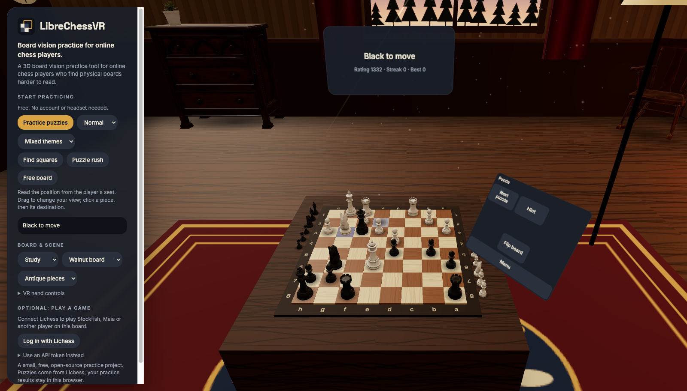

<p align="center"></p>

**Chess in VR, straight from your headset's browser. Nothing to install.**

Open [librechessvr.com](https://librechessvr.com/) in the Meta Quest browser, choose
**Enter VR**, and you are seated at a 3D board. Play your Lichess games against people,
Stockfish or Maia, or practice puzzles and square drills. No store, no download, and no
account for practice.

The same board runs in a desktop browser, so it also suits online players who want to get
used to reading a physical board.

LibreChessVR is a small open-source project, licensed under [MIT](LICENSE).

**Current beta: [v0.1.0-beta.1](https://github.com/comino/LibreChessVR/releases/tag/v0.1.0-beta.1).**
See the [changelog](CHANGELOG.md) for release details and beta limitations.

[**Open librechessvr.com**](https://librechessvr.com/)

A Lichess account is only needed to play games. Puzzles, square drills and the free board
work without one, with or without a headset.

## Trailer

https://github.com/user-attachments/assets/50765291-0f96-4ddf-828c-3ca078cba171

*30 seconds. Your Lichess. In VR. Free, open source, MIT.*

## Try it

1. Open [LibreChessVR](https://librechessvr.com/).
2. Choose **Practice puzzles**, **Find squares**, or **Free board**.
3. Read the position from the player's seat. Drag to change the view; click a piece and then
   its destination. You can change the board, pieces and scene.
4. On a compatible headset, choose **Enter VR** to sit at the board. Point with a controller,
   point and pinch with your hands, or pick pieces up directly.

On desktop, **Hide controls** recenters the board and keeps activity actions within reach.
**Show controls** restores the sidebar; your choice is remembered. During games, player clocks
stay visible beside the play area as you rotate or zoom the board.

In VR, **Menu** opens Practice, Free board, Play and Settings. **Back** goes up one level;
**Return** takes you back to the same activity and position. Timed games and drills keep
running while you browse settings.



## Practice modes

- **Puzzles:** Lichess puzzles on a 3D board, with difficulty, themes, hints and a streak counter.
- **Find squares:** 30-second coordinate drills from both White's and Black's perspective.
- **Free board:** move both sides, Undo and Reset. Menu navigation preserves your move history.
- **Puzzle rush:** three minutes and three lives, with difficulty increasing as you solve.
- **Blindfold practice:** ghost or hide pieces, reveal them briefly, and optionally hear moves.
  These controls are under Practice → Puzzles → Piece visibility and Settings → Input & audio.

## Optional games and VR

Connect Lichess to play Stockfish, the Maia bots or another player on the same 3D board.
Games support premoves, draw and takeback responses, promotion, rematches and post-game review.
Seeks against humans require rapid or slower; blitz works for direct engine challenges.

In VR you can adjust table height and board size, switch between hand and controller input,
and use the same settings without leaving a game. Scenes include Study, Sunset, Night and
Minimal. Appearance changes are previews on the board, with visible setting choices.
Knights show their side profile by default. **Settings → Appearance → Knight facing**
offers Right, Forward, Left and Backward, from each player's side. The desktop sidebar
has the same setting, and your choice is remembered.

On Quest, open [librechessvr.com](https://librechessvr.com/) in the browser. You can also use
*Install app*. The optional Android wrapper can be built with `android/build.sh` and installed
with `adb install -r android/app-release-signed.apk`.

## Data

Practice needs no login. Puzzles are fetched anonymously from Lichess. Puzzle results and
practice records stay in your browser and are not sent to your Lichess account. If you connect
Lichess for games, the login token stays in your browser.

When moving from an earlier address to librechessvr.com, sign in to Lichess again.
Browser settings and practice records are stored separately for each address.

## Run locally

```sh
git clone https://github.com/comino/LibreChessVR.git
cd LibreChessVR
python3 -m http.server 8123
```

Open `http://localhost:8123` in your browser. No build step or API key is needed.
WebXR requires HTTPS or localhost. For a Quest in developer mode, use
`adb reverse tcp:8123 tcp:8123`, then visit `http://localhost:8123` on the headset.

To host your own copy, serve `index.html`, `manifest.webmanifest`, `sw.js`, `LICENSE`,
`THIRD_PARTY_NOTICES.md`, `src/` and `assets/` on any static HTTPS host. Libraries and fonts
load from their CDNs; puzzles and optional games use Lichess. The configurations in `deploy/`
and `android/` describe the maintained instance; use your own host and signing key for a fork.

The [beta release](https://github.com/comino/LibreChessVR/releases/tag/v0.1.0-beta.1)
also includes a static web ZIP and SHA-256 checksums. Extract the ZIP and serve its
contents; no build step is needed. See [installation instructions](INSTALL.md).

## Development

Static ES modules (Three.js 0.170 + chess.js 1.0 from a CDN import map). Architecture
and invariants: [`docs/ARCHITECTURE.md`](docs/ARCHITECTURE.md); hosting and packaging:
[`docs/OPERATIONS.md`](docs/OPERATIONS.md). Brand & design system: [`BRAND.md`](BRAND.md);
tokens in [`src/theme.js`](src/theme.js).

Tests need Node.js 22 or newer and Chrome/Chromium. The smoke script finds Chrome or Chromium
itself; otherwise set `CHROME` to your browser executable.

```sh
node test/run-tests.mjs                        # 4 unit suites + 16 headless-Chrome suites, all must pass
```

The smoke suites drive the real modules against a fake lichess (streams, reconnects, offers,
premoves), fake hands and controllers, and the real 2D page. `hunt-*` suites are regression
tests from adversarial bug hunts.

## Contributing

Issues and pull requests are welcome at [comino/LibreChessVR](https://github.com/comino/LibreChessVR).
For interaction bugs, include your browser or headset, whether you used hands or controllers,
and the steps to reproduce the problem. Run the checks above for code changes; include a
screenshot for visual changes and say whether you tested on a headset.

The project focuses on helping online players read physical chessboards. Contributions to
board readability, practice exercises and comfortable interaction are especially useful.

## License and credits

Project code and original artwork are covered by the [MIT license](LICENSE).
Third-party models, libraries and fonts keep their own licenses; see
[THIRD_PARTY_NOTICES.md](THIRD_PARTY_NOTICES.md), including attribution for the model in older commits.

Chess pieces ([Chess Set](https://polyhaven.com/a/chess_set) by Riley Queen) and scene furniture
(`assets/props/`) are scanned models from [Poly Haven](https://polyhaven.com), CC0.
